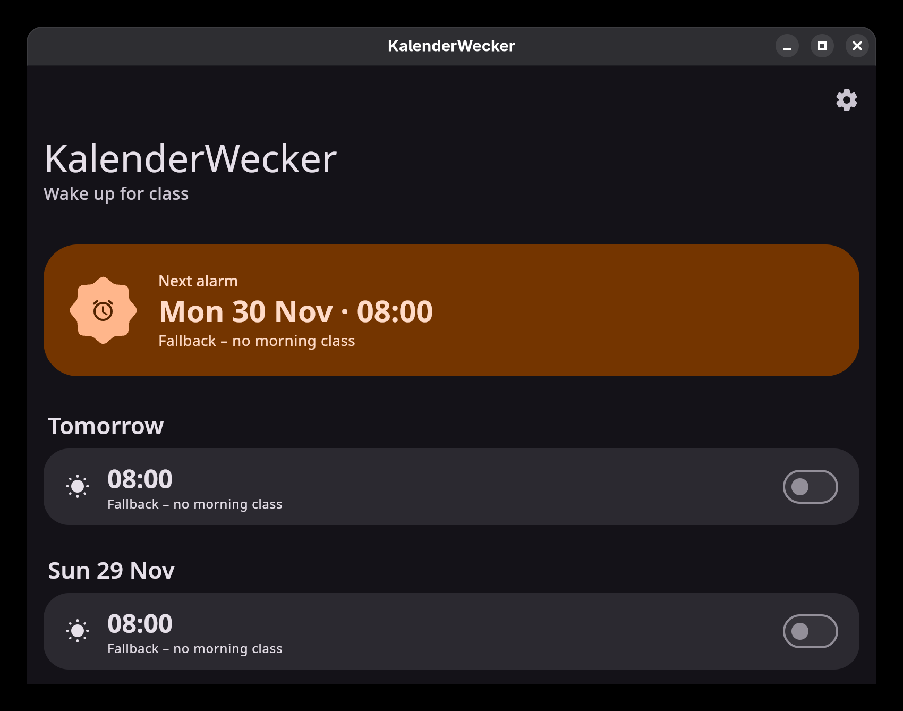

# KalenderWecker

Wake-up alarms driven by your Jönköping University TimeEdit schedule.

Paste your TimeEdit calendar link (the `.ics` subscription link, the `.html` schedule page or a
`webcal://` link) and the app lists your upcoming classes. Every day gets one alarm:

- **first class before "morning ends at"** (default 12:00) → alarm = class start − offset (default 1 h 30 min)
- **otherwise** → the fallback alarm (default 08:00, on Mon–Fri by default)

Each day's alarm can be switched on/off, you can pick any audio file as the wake-up sound, and
alarms snooze for 5 minutes / stop by themselves after 10 minutes.

The app is available in **English, German and Swedish**. It follows the system language;
Settings → Language overrides it (on Android 13+ the choice also shows up in the system's
per-app language setting).



## How alarms ring

| Platform | Mechanism | Rings when app is closed? |
|----------|-----------|---------------------------|
| Android  | `AlarmManager.setAlarmClock` → foreground service + full-screen lock-screen activity; re-planned after reboot / time change; TimeEdit refreshed every 6 h (WorkManager) | yes |
| Linux desktop with systemd | one `kalenderwecker-alarm-<date>.timer` per alarm in `~/.config/systemd/user/`, which launches the app with `--ring <date>`; `kalenderwecker-refresh.timer` runs `--refresh` every 6 h | yes (machine must be awake; user timers can't wake it from suspend) |
| Other desktops | in-process timer | only while the window is open |

Inspect the desktop timers with `systemctl --user list-timers 'kalenderwecker*'`.
Desktop settings live in `~/.config/kalenderwecker/settings.properties`.

The timers start the app with the command it was last launched with (`./gradlew run` → the
build-directory classpath). For an installed build set `KALENDERWECKER_EXEC` to the launcher,
open the app once, and the units are rewritten.

On Android the app asks for notifications; the home screen shows a banner if notifications,
exact alarms or full-screen alarms are not allowed.

## Development

```
nix develop        # or: direnv allow  — JDK 25, Gradle, adb, Compose Desktop native libs
./gradlew :core:jvmTest :app:shared:jvmTest :app:desktopApp:test :app:androidApp:testDebugUnitTest
```

CI (`.github/workflows/ci.yml`) runs the same commands inside `nix develop` on every push to `master` and every pull request, and uploads the debug APK as an artifact.

Design and plan: [`docs/superpowers/specs`](docs/superpowers/specs), [`docs/superpowers/plans`](docs/superpowers/plans).

## Project layout

This is a Kotlin Multiplatform project targeting Android, iOS, Web, Desktop (JVM), Server.

* [/app/iosApp](./app/iosApp/iosApp) contains an iOS application. Even if you’re sharing your UI with Compose Multiplatform,
  you need this entry point for your iOS app. This is also where you should add SwiftUI code for your project.

* [/app/shared](./app/shared/src) is for code that will be shared across your Compose Multiplatform applications.
  It contains several subfolders:
  - [commonMain](./app/shared/src/commonMain/kotlin) is for code that’s common for all targets.
  - Other folders are for Kotlin code that will be compiled for only the platform indicated in the folder name.
    For example, if you want to use Apple’s CoreCrypto for the iOS part of your Kotlin app,
    the [iosMain](./app/shared/src/iosMain/kotlin) folder would be the right place for such calls.
    Similarly, if you want to edit the Desktop (JVM) specific part, the [jvmMain](./app/shared/src/jvmMain/kotlin)
    folder is the appropriate location.

* [/core](./core/src) is for the code that will be shared between all targets in the project.
  The most important subfolder is [commonMain](./core/src/commonMain/kotlin). If preferred, you
  can add code to the platform-specific folders here too.

* [/server](./server/src/main/kotlin) is for the Ktor server application.

### Running the apps

Use the run configurations provided by the run widget in your IDE's toolbar. You can also use these commands and options:

- Android app: `./gradlew :app:androidApp:assembleDebug`
- Desktop app:
  - Hot reload: `./gradlew :app:desktopApp:hotRun --auto`
  - Standard run: `./gradlew :app:desktopApp:run`
- Server: `./gradlew :server:run`
- Web app:
  - Wasm target (faster, modern browsers): `./gradlew :app:webApp:wasmJsBrowserDevelopmentRun`
  - JS target (slower, supports older browsers): `./gradlew :app:webApp:jsBrowserDevelopmentRun`
- iOS app: open the [/app/iosApp](./app/iosApp) directory in Xcode and run it from there.

### Running tests

Use the run button in your IDE's editor gutter, or run tests using Gradle tasks:

- Android tests: `./gradlew :app:shared:testAndroidHostTest`
- Desktop tests: `./gradlew :app:shared:jvmTest :app:desktopApp:test`
- Core logic (planner, repositories): `./gradlew :core:jvmTest`
- Server tests: `./gradlew :server:test`
- Web tests:
  - Wasm target: `./gradlew :app:shared:wasmJsTest`
  - JS target: `./gradlew :app:shared:jsTest`
- iOS tests: `./gradlew :app:shared:iosSimulatorArm64Test`

---

Learn more about [Kotlin Multiplatform](https://www.jetbrains.com/help/kotlin-multiplatform-dev/get-started.html),
[Compose Multiplatform](https://kotlinlang.org/compose-multiplatform/),
[Kotlin/Wasm](https://kotl.in/wasm/)…

We would appreciate your feedback on Compose/Web and Kotlin/Wasm in the public Slack channel [#compose-web](https://slack-chats.kotlinlang.org/c/compose-web).
If you face any issues, please report them on [YouTrack](https://youtrack.jetbrains.com/newIssue?project=CMP).